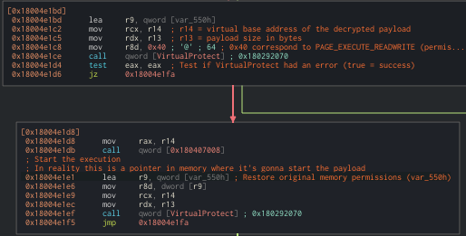

# 01 — In-Memory Staging & Shellcode Execution (`VirtualProtect`)

## Overview
After `ffmpeg.dll` locates the little-endian `0xFEEDFACE` signature in its overlay and decrypts the secondary payload (`d3dcompiler_47.dll`) via RC4, the resulting shellcode resides in a standard `PAGE_READWRITE` (`RW`) buffer.

## Key Mechanisms
* **Bypassing DEP / NX:** Windows Data Execution Prevention blocks instruction execution from standard heap/data buffers.
* **Dynamic Permission Escalation:** The loader invokes `VirtualProtect` with `flNewProtect = 0x40` (`PAGE_EXECUTE_READWRITE`), passing the payload virtual base address (`r14` $\rightarrow$ `rcx`) and size in bytes (`r13` $\rightarrow$ `rdx`).
* **Fileless Execution Handoff:** Control flow jumps directly to the decrypted shellcode entry point in RAM without writing artifacts to disk.
* **Cleanup:** Once the shellcode call returns, `VirtualProtect` is invoked a second time using `var_550h` to restore the original memory protection flags.

## Disassembly Evidence (Cutter)
