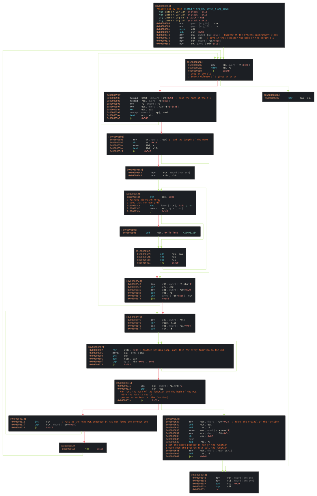

# 02 — Dynamic API Resolution: PEB Walking

## Overview
Because the decrypted `d3dcompiler_47.dll` shellcode is executed directly in RAM as Position-Independent Code (PIC) without going through the standard Windows OS loader, it lacks an Import Address Table (IAT). To invoke system functions (`LoadLibraryA`, `WinHttpOpen`, etc.), it must manually locate loaded system DLLs in memory via **PEB Walking**.

## Traversal Chain (x64)
1. **TEB to PEB (`gs:[0x60]`):** Reads the `GS` segment register at offset `0x60` to retrieve the virtual address of the Process Environment Block (`PEB`).
2. **Loader Data (`PEB + 0x18`):** Follows the `Ldr` pointer to access the `PEB_LDR_DATA` structure.
3. **Module Enumeration (`InMemoryOrderModuleList`):** Traverses the doubly-linked list (`Flink` pointers) of `LDR_DATA_TABLE_ENTRY` structures representing every DLL loaded in the process, extracting the `DllBase` address of target modules (`ntdll.dll`, `kernel32.dll`).
4. **Export Table Parsing (`IMAGE_EXPORT_DIRECTORY`):** Navigates from `DllBase` (`e_lfanew` $\rightarrow$ PE Optional Header Data Directories) to the Export Directory, iterating through the parallel arrays `AddressOfNames`, `AddressOfNameOrdinals`, and `AddressOfFunctions` to enumerate exported APIs.

## Disassembly Evidence (Full Control Flow Graph)

The complete control flow graph of the resolver routine (covering PEB traversal, Export Directory parsing, and the `ROR` hashing loops) is available in the vector diagram below. **Click the image or [open the full-resolution SVG](./images/api-resolver-graph.svg) to zoom into individual basic blocks and loops.**

